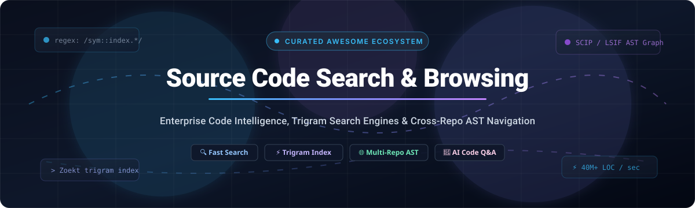

# Awesome-Source-Code-Search-Repository-Browsing 🔎

  

  
  
  
  
  
  
  

## 🌐 Curated List of SaaS Products & Open-Source GitHub Projects

> Comprehensive ecosystem directory of code search engines, enterprise code intelligence, cross-repository AST navigation, and self-hosted source code indexing infrastructure. ⚡

**Last updated:** October 2026 📅

This repository tracks top-tier **SaaS platforms** and **open-source projects** designed for **Source Code Search & Repository Browsing**. These developer productivity solutions empower engineering organizations to index, discover, navigate, and comprehend codebases across thousands of repositories and code hosts—offering instantaneous literal regex search, AST symbol resolution, and cross-repo definition jumping. 🚀

---

## 📑 Table of Contents

- [📊 Sector Overview & Market Dynamics](#-sector-overview--market-dynamics)
- [☁️ SaaS / Hosted Platforms](#️-saas--hosted-platforms)
- [💻 Open-Source GitHub Projects](#-open-source-github-projects)
  - [🏆 Top Open-Source Projects (Ranked by Stars)](#-top-open-source-projects-ranked-by-stars)
  - [⚙️ Search Engines & Indexing Engines](#️-search-engines--indexing-engines)
  - [🏢 Self-Hosted Code Search Platforms](#-self-hosted-code-search-platforms)
  - [🖥️ Specialized CLI & Navigation Utilities](#️-specialized-cli--navigation-utilities)
- [🤝 How to Contribute](#-how-to-contribute)
- [💖 Support](#-support)
- [⭐ Star History](#-star-history)
- [⚖️ Disclaimer & Security Guidelines](#️-disclaimer--security-guidelines)

---

## 📊 Sector Overview & Market Dynamics

The global enterprise code search and developer code intelligence sector is estimated at **$1.8B to $2.5B**, expanding rapidly alongside developer productivity tooling, AI agentic programming assistants, and monolithic-to-polyrepo scale. 📈

The market exhibits **moderate fragmentation with strong winner-take-most dynamics at the code hosting layer** (dominated by hyperscalers Microsoft GitHub and GitLab with native code search), while remaining **highly competitive in the cross-repository universal code intelligence and specialized AI codebase comprehension tier** (led by Sourcegraph, Synopsys/Black Duck, and next-generation AI context engines like Greptile). 🎯

---

## ☁️ SaaS / Hosted Platforms

The table below catalogs enterprise SaaS products sorted in descending order by estimated company valuation / annual revenue scale. 🏢

| Product 🏷️ | Scale (Valuation / Revenue) 💰 | Pricing (Starting Tier) 💵 | Free Tier Limit / Trial Duration 🎁 | Core Focus & Search Capabilities 🔍 |
| :--- | :--- | :--- | :--- | :--- |
| **[GitHub Code Search](https://github.com/)** | **~$3,000B ($3.0T)** Microsoft Market Cap | **$4.00 / user / month** (GitHub Team tier) | **Free forever**: Unlimited public repos, unlimited private repos with basic code search & syntax highlighting | Hyperscale native code search with regex, boolean expressions, symbols, and scope qualifiers (`repo:`, `path:`, `symbol:`, `lang:`) |
| **[GitLab Code Search](https://about.gitlab.com/)** | **~$7.5B - $8.5B** Public Market Cap | **$29.00 / user / month** (GitLab Premium tier) | **Free forever plan**: Includes basic file search; Zoekt-powered exact regex search is available on 30-day Free Trial of GitLab Ultimate (up to 100 users) | Native Git code intelligence and multi-project Zoekt-powered exact and regular expression code search |
| **[FishEye (Atlassian)](https://www.atlassian.com/software/fisheye)** | **~$50B+** Atlassian Market Cap | **$10.00 one-time** (Starter tier for up to 5 committers; $1,800 for 10 committers) | **30-day free trial**: Full commercial server license for unlimited repositories and committers | Legacy revision control browser for Subversion, Git, Perforce, CVS, and Mercurial with Jira link integration |
| **[Black Duck Hub](https://www.blackduck.com/)** | **~$2.1B** Acquisition Valuation | **~$1,500.00 / project / year** (Custom quote starting tier for SME application scanning) | **14-day free trial**: Access to Hub demo environment scanning up to 5 application repositories | Open source dependency indexing, Software Bill of Materials (SBOM), and vulnerability/license compliance scanning |
| **[Sourcegraph](https://sourcegraph.com/)** | **~$2.625B** Peak Valuation | **$59.00 / user / month** (Enterprise Code Search tier) | **Free forever plan**: Unlimited search across public repositories on Sourcegraph.com; Free trial: 14-day Enterprise trial for internal self-hosted repos | Benchmark enterprise universal code intelligence, cross-code-host indexing, hover tooltips, and SCIP/LSIF code graph navigation |
| **[Greptile](https://www.greptile.com/)** | **~$25M - $40M** Early-Stage Venture Valuation | **$30.00 / developer / month** (Pro tier for teams) | **Free forever plan**: Up to 3 private repositories (under 10,000 lines of code) with 200 API queries/month; 14-day trial for Team tier | AI-native codebase vector indexing and LLM context engine for multi-repository architectural Q&A, onboarding, and PR reviews |

---

## 💻 Open-Source GitHub Projects

Open-source code search tooling provides battle-tested indexing engines, self-hosted web platforms, and lightning-fast developer utilities. 🛠️

### 🏆 Top Open-Source Projects (Ranked by Stars)

Every repository below is sorted in descending order by its community Stars_Count. Click the white Stars_Badge to view live stargazers! ⭐

| Rank 🏅 | Repository 📦 | GitHub Stars_Count ⭐ | License 📜 | Tech Stack ⚙️ | Description 💡 |
| :---: | :--- | :--- | :--- | :--- | :--- |
| **1** | **[ripgrep](https://github.com/BurntSushi/ripgrep)** |  | Unlicense / MIT | Rust | Fast line-oriented CLI search utility that respects `.gitignore` rules, serving as the foundational search backend for modern developer workflows. |
| **2** | **[bloop](https://github.com/BloopAI/bloop)** |  | Apache-2.0 | Rust / TypeScript | AI-native code search engine providing semantic vector search, regex pattern matching, and contextual natural language codebase comprehension. |
| **3** | **[Hound](https://github.com/hound-search/hound)** |  | MIT | Go / React | Extremely lightweight regex code search tool powered by a Go web front-end and indexed search backend, ideal for small-to-mid engineering teams. |
| **4** | **[OpenGrok](https://github.com/oracle/opengrok)** |  | CDDL-1.0 | Java / Lucene | Enterprise-grade source code search and cross-reference engine designed for massive C, C++, and Java trees, providing AST navigation and VCS history. |
| **5** | **[google/codesearch](https://github.com/google/codesearch)** |  | BSD-3-Clause | Go / C++ | Fast, indexed regular expression search engine over large file trees, pioneered by Russ Cox as the blueprint for trigram index engines. |
| **6** | **[Sourcebot](https://github.com/sourcebot-dev/sourcebot)** |  | AGPL-3.0 | TypeScript / Rust / Go | Complete self-hosted Sourcegraph alternative featuring cross-repository trigram regex indexing, symbol definitions, and AI-assisted codebase Q&A. |
| **7** | **[Livegrep](https://github.com/livegrep/livegrep)** |  | GPL-2.0 | C++ / Go | Real-time interactive regex code search engine built with suffix arrays and trigram indexes for instantaneous query execution over gigabytes of code. |
| **8** | **[Zoekt](https://github.com/sourcegraph/zoekt)** |  | Apache-2.0 | Go / Ctags | High-performance trigram-indexed code search engine powering Sourcegraph and GitLab's exact search; supports symbol ranking, JSON APIs, and gRPC. |
| **9** | **[SeaGOAT](https://github.com/kantord/SeaGOAT)** |  | AGPL-3.0 | Python / Chroma | Local-first semantic code search engine leveraging vector embeddings and ChromaDB to query codebases semantically without cloud dependencies. |
| **10** | **[codespelunker (cs)](https://github.com/boyter/cs)** |  | MIT | Go | High-speed structural code search tool featuring CLI, TUI, and HTTP interfaces that ranks results by relevance without requiring upfront indexing. |
| **11** | **[SCIP](https://github.com/sourcegraph/scip)** |  | Apache-2.0 | Protocol Buffers | Standard Code Intelligence Protocol defining code indexing schemas for cross-repository cross-referencing, hover documentation, and symbol linking. |
| **12** | **[searchcode-server](https://github.com/boyter/searchcode-server)** |  | Apache-2.0 | Java / Lucene | Self-hosted code search server indexing multiple repositories across Git, SVN, and Mercurial with an integrated web UI and syntax highlight viewer. |

---

### ⚙️ Search Engines & Indexing Engines

- ⚡ **[Zoekt](https://github.com/sourcegraph/zoekt)** — Trigram-based search engine maintained by Sourcegraph. Indexes AST symbols with Universal Ctags and powers exact regex search for GitHub-scale platforms.
- 🔬 **[google/codesearch](https://github.com/google/codesearch)** — Foundational regexp indexing engine for massive file trees using 3-character n-grams.
- 🏎️ **[Livegrep](https://github.com/livegrep/livegrep)** — Substring and regex search over gigabytes of source code with sub-second response times.
- 🌐 **[SCIP Protocol](https://github.com/sourcegraph/scip)** — Open standard schema for indexing symbol definitions and references across languages.

### 🏢 Self-Hosted Code Search Platforms

- 🤖 **[Sourcebot](https://github.com/sourcebot-dev/sourcebot)** — Modern turnkey self-hosted code search platform with Docker Compose deployment, code navigation, and "Ask Sourcebot" AI Q&A.
- 🏛️ **[OpenGrok](https://github.com/oracle/opengrok)** — Proven cross-reference engine for deep AST symbol tracking in legacy C/C++/Java repositories.
- 🐶 **[Hound](https://github.com/hound-search/hound)** — Minimalist multi-repo grep server for engineering teams needing rapid browser-based lookups.
- 📦 **[searchcode-server](https://github.com/boyter/searchcode-server)** — Self-hosted search engine supporting Git, SVN, and Mercurial repos.

### 🖥️ Specialized CLI & Navigation Utilities

- ⚡ **[ripgrep](https://github.com/BurntSushi/ripgrep)** — Ultra-fast recursive regex search engine respecting `.gitignore` patterns.
- 🧠 **[bloop](https://github.com/BloopAI/bloop)** — Desktop and server-based AI search engine combining GPT-4 with semantic vector search.
- 🐐 **[SeaGOAT](https://github.com/kantord/SeaGOAT)** — Semantic code search utility running completely locally on your workstation.
- 🔎 **[codespelunker (cs)](https://github.com/boyter/cs)** — Smart relevance-ranked code discovery CLI with built-in TUI and HTTP server.

---

## 🤝 How to Contribute

Contributions are warmly welcomed! Help keep this source code search ecosystem directory up to date: 🌟

1. 🍴 **Fork** this repository.
2. 🌿 Create a feature branch: `git checkout -b add-code-search-tool`.
3. 📝 Update `README.md` following the established table format and badges.
4. 🔍 Ensure pricing, company metrics, and GitHub Stars_Counts reflect current data.
5. 🚀 Submit a **Pull Request** with a descriptive summary of your additions.

---

## 💖 Support

If you find this repository helpful for discovering and evaluating code search solutions, please consider supporting the project:

- ⭐ **Star this repository** on GitHub to help others find it!
- 🍴 **Fork and contribute** by adding new tools, features, or price updates.
- 📢 **Share** with your network, team, and developer communities.
- ☕ **Buy me a coffee / Sponsor**: Support ongoing maintenance directly via the [GitHub Sponsor Dashboard](https://github.com/sponsors/ishandutta2007).

Thank you so much for your support! 🙏

---

## ⭐ Star History

---

## ⚖️ Disclaimer & Security Guidelines

- 🛡️ **Access Control & Network Security**: Self-hosted code search engines index complete company source trees. Ensure your indexing clusters have role-based access control (RBAC), TLS encryption in transit and at rest, and VPC isolation.
- 📊 **Engine vs. Product Architecture**: Low-level search engines like Zoekt require an operational layer (git syncer, permission gateway, UI). Ready-to-run platforms like Sourcebot or SaaS platforms like Sourcegraph provide complete end-to-end solutions.
- 📜 **Licensing**: Always review project licenses (e.g., Apache-2.0, MIT, AGPL-3.0, CDDL-1.0) before deploying internal production instances.

---

  Built with ❤️ by and for platform engineers, architects, and developers building the future of code intelligence. 🚀

